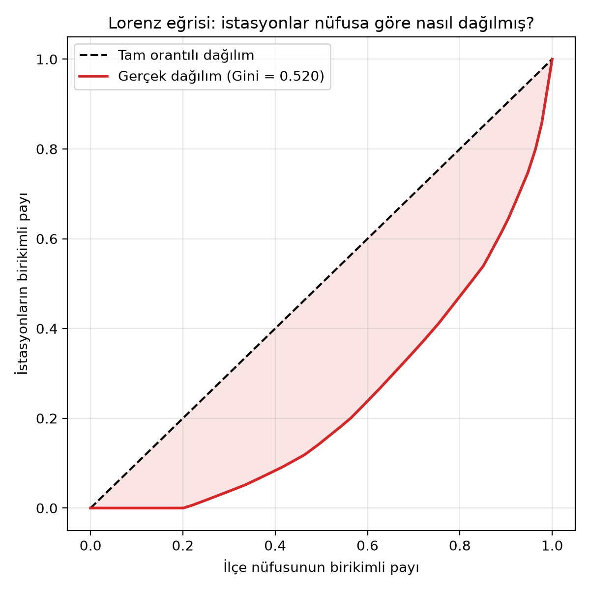
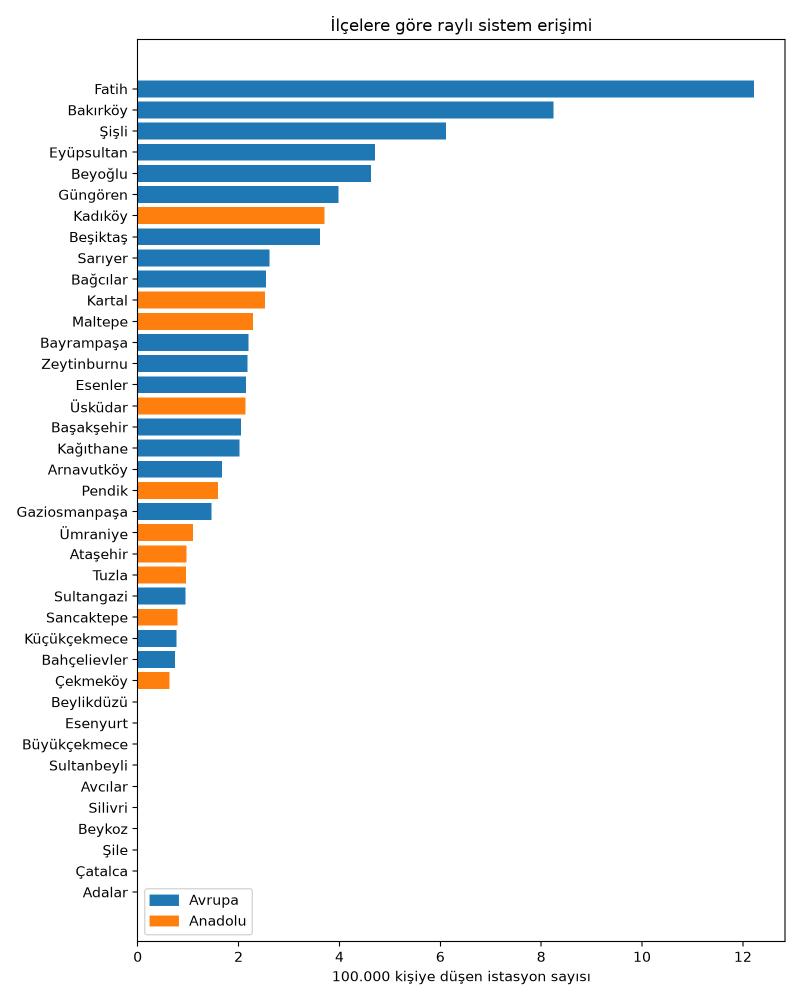

# İstanbul'da İlçelerin Raylı Sistem Erişimi

Araştırma Yöntem ve Teknikleri dersi dönem projesi (2026-2027 Güz).

Yunus Yeğen, Marmara Üniversitesi, Bilgisayar Programcılığı (uzaktan öğretim), 1. sınıf.
Proje bireyseldir, ekip arkadaşım yok.

## 1. Konu ve problem durumu

İstanbul'da metro, tramvay ve banliyö hatları her yıl biraz daha uzuyor. Ama bu hatlar şehre eşit
dağılmıyor. Bazı ilçelerde onlarca istasyon varken bazı ilçelerde hiç istasyon yok. Raylı sistem
trafiğe takılmadan işe, okula ve hastaneye gitmeyi kolaylaştırdığı için bir ilçede istasyon olup
olmaması orada yaşayanlar için fark yaratıyor. Buna rağmen istasyonların ilçelere dağılımının
nüfusla ne kadar uyumlu olduğu çoğunlukla tahminle konuşuluyor. İBB ve TÜİK verilerini açık
yayımladığı için bu soru tahminle değil sayılarla incelenebilir. Bu projede istasyonların ilçelere
dağılımını ilçe nüfusuyla karşılaştırıyorum.

## 2. Problem cümlesi ve alt problemler

**Problem cümlesi:** İstanbul'da raylı sistem istasyonlarının ilçelere dağılımı, ilçelerin nüfusu
ile orantılı mıdır?

**"Orantılı" ne demek?** Bu soruyu ölçebilmek için kavramı tanımlamam gerekiyor. İstasyonlar nüfusla
tam orantılı dağılsaydı, 100.000 kişiye düşen istasyon sayısı bütün ilçelerde **aynı** olurdu. O
hâlde orantılılığı, bu sayının ilçeler arasında ne kadar değiştiğine bakarak ölçüyorum. Bunun için
değişim katsayısı ve Gini katsayısı kullanıyorum (bkz. 8. Yöntem).

**Alt problemler:**

1. İstanbul'un 39 ilçesinde kaç raylı sistem istasyonu var ve 100.000 kişiye kaç istasyon düşüyor?
2. Raylı sisteme erişimi en yüksek ve en düşük olan ilçeler hangileri?
3. İlçe nüfusu ile istasyon sayısı arasında ilişki var mı?
4. 100.000 kişiye düşen istasyon sayısı Avrupa ve Anadolu yakasına göre değişiyor mu?

## 3. Amaç ve önem

**Amaç:** Bu araştırmanın amacı, İstanbul'daki raylı sistem istasyonlarının ilçelere dağılımını
incelemek ve bu dağılımı ilçe nüfusu ve yaka ile karşılaştırmaktır.

**Önem:** Bulgular, nüfusuna göre raylı sistem erişimi düşük kalan ilçeleri gösterebilir. Bu da yeni
hat planlaması üzerine yapılan tartışmalara küçük bir katkı sağlayabilir.

## 4. Değişkenler ve işlevsel tanımları

| Değişken | Rolü | Türü | İşlevsel tanım | Birim |
|---|---|---|---|---|
| İlçe nüfusu | Bağımsız | Sayısal (oranlı) | TÜİK ADNKS 2025 sonuçlarına göre ilçenin toplam nüfusu | kişi |
| Yaka | Bağımsız | Kategorik (sınıflama) | İlçenin bulunduğu yaka | Avrupa / Anadolu |
| İstasyon sayısı | Bağımlı | Sayısal (oranlı) | İBB istasyon veri setinde o ilçeye kayıtlı, birbirinden farklı istasyonların sayısı | adet |
| 100.000 kişiye düşen istasyon | Bağımlı | Sayısal (oranlı) | (istasyon sayısı / ilçe nüfusu) x 100.000 | adet |

İstasyon sayısı için not: İBB veri setinde aynı istasyon çok sayıda satırda tekrar ediyor. Ayrıca
bazı istasyonlar `Sirkeci-1`, `Sirkeci-2` ya da `MAHMUTBEY M7 HOL 1` gibi girişlere göre ayrı ayrı
yazılmış. Bunların hepsi tek istasyon olarak sayılıyor. Nasıl saydığım `analiz/analiz.ipynb`
dosyasında adım adım yazıyor.

## 5. Hipotezler

**H1 (yönlü):** İlçe nüfusu arttıkça istasyon sayısı artar.
**H0:** İlçe nüfusu ile istasyon sayısı arasında ilişki yoktur.

**H2 (yönsüz):** 100.000 kişiye düşen istasyon sayısı Avrupa ve Anadolu yakası arasında farklıdır.
**H0:** 100.000 kişiye düşen istasyon sayısı iki yaka arasında farklı değildir.

**H2'yi neden kurdum?** İstanbul'un ilk metro ve tramvay hatları Avrupa yakasında açıldı ve tarihî
merkez, merkezî iş alanı ile havalimanlarının çoğu bu yakada. Raylı sistem yatırımları uzun yıllar
boyunca bu yakada yoğunlaştığı için iki yaka arasında bir fark olmasını bekledim. Yönünü önceden
kestiremediğim için hipotezi yönsüz kurdum.

## 6. Sayıltılar

- İBB'nin yayımladığı istasyon ve ilçe bilgilerinin doğru kaydedildiği varsayılmıştır.
- TÜİK nüfus verilerinin ilçelerin gerçek nüfusunu yansıttığı varsayılmıştır.
- Bir ilçedeki istasyon sayısının, o ilçede yaşayanların raylı sisteme erişimi hakkında fikir
  verdiği varsayılmıştır.

## 7. Sınırlılıklar

- Araştırma İstanbul'un 39 ilçesi ve 2025 yılı verisiyle sınırlıdır.
- İBB veri setinde Kocaeli sınırlarındaki Gebze, Darıca ve Çayırova istasyonları da var. Bunlar
  İstanbul ilçesi olmadığı için analiz dışında bırakıldı.
- İBB verisinde 13 istasyon birden fazla ilçeye kayıtlı görünüyor. Bunları şimdilik veride en
  çok geçtikleri ilçeye saydım. Hepsinin listesi analiz not defterinde yazıyor. Bu 13 istasyonu
  İBB hat haritasından tek tek kontrol edip gerekirse düzelteceğim.
- İstasyon sayısı, kişinin istasyona ne kadar yürüdüğünü ve seferlerin ne sıklıkta geçtiğini
  ölçmez. Bir ilçenin kenarındaki istasyon, ilçenin her yerine yakın demek değildir.
- İlçelerin yüzölçümü analize girmiyor. Çatalca ve Silivri gibi çok geniş ve kırsal ilçelerle
  Güngören gibi küçük ve yoğun ilçeler aynı tabloda karşılaştırılıyor. Nüfus yoğunluğu, ilçenin
  kent merkezine uzaklığı ve işyeri sayısı gibi değişkenler sonucu etkiliyor olabilir. Gökçe
  (2024) işyeri sayısının nüfustan iki kat etkili olduğunu bulmuş. Bu değişkenleri eklemek
  dönemin sonraki aşamasına bırakıldı.
- Analiz 39 ilçe üzerinde yapıldığı için gözlem sayısı az. Bu, istatistiksel testlerin zayıf bir
  ilişkiyi yakalama gücünü düşürüyor.
- Veri setinde teleferik, füniküler, Tünel ve nostaljik tramvay da raylı sistem olarak geçiyor.
  Bunlar şehir içi ulaşımda metro kadar kullanılmasa da sayıma dahil edildi.
- Metrobüs raylı sistem olmadığı için kapsam dışıdır.
- Veri setinin kapsadığı tarihten sonra açılan istasyonlar araştırmaya dahil değildir.

## 8. Yöntem

- **Araştırma türü:** Nicel, ikincil veri analizi (açık veri)
- **Evren:** İstanbul'un 39 ilçesi. Evrenin tamamı incelendiği için örneklem seçilmedi (tam sayım).
- **Analiz:**
  - Alt problem 1 ve 2: betimsel istatistik (ortalama, medyan, en büyük ve en küçük değer) ve
    sütun grafiği
  - Problem cümlesinin doğrudan cevabı: değişim katsayısı, Gini katsayısı ve Lorenz eğrisi. Bu
    yöntemi literatürden aldım; Zhu ve Rui (2025) ile Li ve ark. (2025) raylı sistem erişiminin
    eşitliğini tam olarak bu ölçülerle değerlendiriyor
  - Alt problem 3 (H1): saçılım grafiği, Pearson ve Spearman korelasyon katsayısı
  - Alt problem 4 (H2): iki yakanın ortalama ve medyanlarının karşılaştırılması, kutu grafiği ve
    Mann-Whitney U testi. Bu test, grup sayıları küçük olduğunda ve veri normal dağılmadığında
    kullanılıyor; burada birçok ilçede değer sıfır olduğu için veri normal dağılmıyor
  - Duyarlılık analizi: verdiğim iki kararın (teleferik ve füniküler gibi hatların dahil edilmesi,
    belirsiz 13 istasyonun ilçeye atanması) sonucu ne kadar değiştirdiğinin kontrolü
- **Araçlar:** Google Colab (Python), GitHub, Overleaf, Zotero

**Yöntemin gerekçesi:** Araştırma sorusu iki sayısal değişken arasındaki ilişkiyi (nüfus ve istasyon
sayısı) ve iki grup arasındaki farkı (Avrupa ve Anadolu yakası) soruyor. Bu yüzden korelasyon ve
grup karşılaştırması uygun. Veriyi kendim toplamak yerine açık veri kullanıyorum, çünkü 39 ilçedeki
bütün istasyonları tek tek saymak bir dönemde mümkün değil ve İBB zaten bu kaydı tutuyor.

**Korelasyon neden tek başına yetmiyor?** Korelasyon "nüfus artarsa istasyon sayısı da artıyor mu?"
sorusunu cevaplıyor. Benim problem cümlem bundan daha güçlü bir şey soruyor: dağılım nüfusla
*orantılı* mı? İkisi aynı değil. Nüfusu 100.000 olan ilçede 10, nüfusu 1.000.000 olan ilçede 11
istasyon olsa korelasyon pozitif çıkar ama dağılım hiç orantılı olmaz. Bu yüzden asıl cevabı Gini
katsayısıyla veriyorum, korelasyonu yardımcı bilgi olarak kullanıyorum.

**Tam sayım ve hipotez testi hakkında bir not:** 39 ilçenin tamamını incelediğim için elimde bir
örneklem değil, evrenin kendisi var. p değeri aslında "bu sonuç örnekleme tesadüfünden doğmuş
olabilir mi?" sorusunu cevaplar; ortada örnekleme olmadığı için bu sorunun burada karşılığı zayıf.
Bu yüzden asıl kanıtım betimsel ölçüler (Gini katsayısı, değişim katsayısı, medyanlar); korelasyon
ve Mann-Whitney U testini bunları destekleyen ikincil bilgi olarak raporluyorum. Testleri,
İstanbul'un 2025'teki durumunu daha geniş bir "büyük şehir ilçeleri" topluluğundan bir kesit kabul
ederek yorumluyorum.

**Anlamlı çıkmaması ne demek değildir:** H0'ın reddedilememesi "ilişki yoktur" anlamına gelmez,
"bu veriyle bir ilişki gösterilemedi" anlamına gelir. 39 ilçe küçük bir sayı olduğu için testin
zayıf bir ilişkiyi yakalama gücü düşük.

Yöntem, literatür taraması ilerledikçe değişebilir.

## 9. Veri setleri

| Veri | Kaynak | Lisans |
|---|---|---|
| Raylı sistem istasyonları (istasyon adı, hat, ilçe) | İBB Açık Veri Portalı | İBB Açık Veri Lisansı |
| İlçe nüfusları (2025) | TÜİK, Adrese Dayalı Nüfus Kayıt Sistemi | Resmî istatistik |

Dosyaların nereden indirildiği ve hangi sütunların kullanıldığı [`veri/README.md`](veri/README.md)
dosyasında yazıyor. Ham veri dosyaları boyutları büyük olduğu için depoya yüklenmedi, indirme
talimatı verildi.

## 10. Etik

Bu araştırma insanlarla değil, kamuya açık ikincil verilerle yapılıyor. Anket yapılmıyor, görüşme
yapılmıyor, bu yüzden katılımcı onamı ve etik kurul izni gerektiren bir durum yok.

- **Kişisel veri yok.** İBB veri setindeki yolcu sayıları istasyon ve gün düzeyinde
  toplulaştırılmış; kimsenin kim olduğu, nereye gittiği yazmıyor. TÜİK verisi de ilçe düzeyinde
  toplam nüfus.
- **Lisanslara uyuluyor.** İBB verisi İBB Açık Veri Lisansı ile, TÜİK verisi resmî istatistik
  olarak yayımlanıyor. İkisinin de kaynağı ve yılı raporda belirtiliyor.
- **Veri izinsiz yeniden yayımlanmıyor.** Ham dosyalar depoya yüklenmedi; yerine indirme talimatı
  verildi (bkz. [`veri/README.md`](veri/README.md)).
- **Depoda kişisel bilgi tutulmuyor.** Öğrenci numarası, telefon ve e-posta gibi bilgiler depoya
  konmuyor.
- **Kaynaklar okunarak kullanılıyor** ve yapay zekâ kullanımı 17. bölümde beyan ediliyor.
- **Sınırlılıklar ve belirsizlikler gizlenmiyor.** Veri temizliğinde verdiğim kararlar ve bunların
  sonuca etkisi duyarlılık analiziyle açıkça gösteriliyor.

## 11. Literatür taraması

Kaynakları Google Akademik, DergiPark, TR Dizin ve YÖK Ulusal Tez Merkezi üzerinden arıyorum.
Okuduğum her kaynağı aşağıdaki tabloya ekliyorum.

Kullandığım arama ifadeleri:
- "raylı sistem erişilebilirlik İstanbul"
- "toplu taşıma erişilebilirlik analizi İstanbul metro istasyon nüfus"
- "public transport accessibility equity"
- "metro station accessibility equity population district"

### Okuma listesi

Aşağıdaki kaynakları buldum ve künyelerini yayıncı sayfasından doğruladım. Okudukça aşağıdaki
karşılaştırma tablosuna işliyorum.

1. Öztaşkın, D. ve Levend, S. (2023). Toplu Taşıma Duraklarının Erişilebilirliği: İstanbul Örneği.
   *Türk Uzaktan Algılama ve CBS Dergisi*, 4(2), 301-318.
   [doi:10.48123/rsgis.1299707](https://doi.org/10.48123/rsgis.1299707)
   Projeme en yakın kaynak. İstanbul'da duraklara yürüme mesafesiyle erişimi ölçüyor.

2. Gökçe, B. (2024). Büyüyen Raylı Toplu Taşıma Sistem Ağında Hatlar ve İstasyonlar: İstanbul
   Örneği. *METU Journal of the Faculty of Architecture*, 41(1), 1-21.
   [doi:10.4305/METU.JFA.2024.1.1](https://doi.org/10.4305/METU.JFA.2024.1.1)
   İstanbul raylı sistem ağını istasyon düzeyinde inceliyor.

3. Cihan, U. ve Üstündağ, K. İ. (2025). A Sustainable Accessibility Approach in Transportation
   Planning: The Case of Istanbul. *Planlama Dergisi*, 35(3), 343-363.
   [doi:10.14744/planlama.2025.90958](https://doi.org/10.14744/planlama.2025.90958)
   İstanbul'da toplu taşımayla işe erişimi ve mekânsal eşitliği ölçüyor.

4. Zhu, J. ve Rui, X. (2025). Spatiotemporal Dynamics and Multi-Scale Equity Evaluation of Urban
   Rail Accessibility: Evidence from Hangzhou. *ISPRS International Journal of Geo-Information*,
   14(9), 361. [doi:10.3390/ijgi14090361](https://doi.org/10.3390/ijgi14090361)
   Raylı sistem erişiminin eşit dağılıp dağılmadığını Gini katsayısı ve Lorenz eğrisiyle ölçüyor.

5. Li, D., Zang, H., Guan, Z. ve Yu, D. (2025). Study on Spatial Distribution and Inequity of Rail
   Transit Travel Accessibility under Multi-modal Traveling: A Case Study of Beijing.
   *Scientific Reports*, 15(1), 15823.
   [doi:10.1038/s41598-025-97066-4](https://doi.org/10.1038/s41598-025-97066-4)
   Pekin'de raylı sistem erişimini ilçe düzeyinde karşılaştırıyor.

6. Alp, G. (2022). *İstanbul'da Raylı Sistem Yatırımlarının Kentin Gelişimi ve Arazi Kullanımı
   Üzerindeki Etkileri: Arnavutköy İlçesi Örneği* (Yüksek lisans tezi). İstanbul Sabahattin Zaim
   Üniversitesi.
   [Açık erişim kaydı](https://openaccess.izu.edu.tr/entities/publication/4440f75d-8ca7-4ba2-bbe1-4f5e23334672)
   Tek bir ilçe üzerinden raylı sistem yatırımının etkisini ele alıyor.

### Karşılaştırma tablosu

| Kaynak | Problem | Veri | Yöntem | Temel bulgu | Sınırlılık | Projeme katkısı |
|---|---|---|---|---|---|---|
| Öztaşkın ve Levend (2023) | İstanbul'da duraklara erişim yeterli mi? | İBB durak ve hat verisi, 2020 bina nüfus verisi | CBS, ArcGIS servis alanı analizi, 5/10/15 dk yürüme | Raylı sisteme 5 dk'da ulaşan nüfus %2,88. Avrupa yakası Anadolu'dan daha iyi | Sefer sıklığı, maliyet ve konfor ölçülmemiş | Yaka farkını benim gibi soruyor, erişimi farklı ölçüyor. Sefer sıklığı sınırlılığı benimkiyle aynı |
| Gökçe (2024) | Ağa eklenen istasyonun yolcu sayısına katkısı neye bağlı? | 186 istasyon, 5 yıl (2013-2022), 745 gözlem, 1 km'deki nüfus ve işyeri | Rastgele etkiler panel veri regresyonu | Nüfus %1 artınca yolcu %0,10 artıyor, işyeri iki kat etkili. Avrupa yakası anlamsız (t=0,68) | Panel veride yıl bazlı eksikler model kalitesini etkiliyor | H1 ve H2 sonuçlarımı destekliyor. İstanbul dışı Marmaray istasyonlarını dışlaması benim temizliğimle aynı |
| Cihan ve Üstündağ (2025) | Toplu taşımayla istihdama erişim adil mi? | 1307 TAZ, 2022 istihdam verisi, 2040 senaryosu, İUAP anketleri | Kümülatif olanaklar yöntemi, 30/60/90 dk eşik, CBS | 60 dk'da erişim %24,41'den %32,55'e çıkıyor. 30 dk'da en düşük değer hiç değişmiyor | Bütün olanaklar eşit ağırlıklı sayılıyor | Merkez ilçelerin (Fatih, Şişli, Beşiktaş, Kadıköy) yüksek çıkması benim tablomla aynı |
| Zhu ve Rui (2025) | Metro ağı büyürken erişim eşit dağılıyor mu? | Hangzhou, 2019 ve 2023 metro ağı, yol ağı, nüfus dağılımı | Ağ tabanlı tampon azalma modeli, Gini katsayısı, Lorenz eğrisi, Moran's I | TAZ ölçeğinde Gini 0,56'dan 0,425'e düşmüş ama grid ölçeğinde 0,404'te kalmış | Ayrı sınırlılık bölümü yok. Tek şehir, iki yıl. Endeks merkezi alanları kayırıyor | Eşitsizliği tek sayıyla ölçmenin yolunu gösteriyor: Gini ve Lorenz. Sonraki aşamada ekleyeceğim |
| Li ve ark. (2025) | İstasyon erişimi ile nüfus yoğunluğu uyuşuyor mu? | Pekin 6. Çevre Yolu içi, Gaode Map API, dört ulaşım türü, nüfus verisi | Gauss tabanlı 2SFCA, Gini katsayısı, IPA | Merkez ve alt merkezlerde erişim yüksek. Erişim en adaletsiz yürüyerek ve toplu taşımayla | Nüfus grupları (yaş, cinsiyet) ayrılmamış, trafik yoğunluğu ve banliyöler kapsam dışı | Erişimi alt bölge düzeyinde karşılaştırıyor. Merkez-çeper farkı benim bulgumla aynı yönde |
| Alp (2022) | Raylı sistem yatırımı ilçeyi nasıl dönüştürür? | Arnavutköy planlama belgeleri, nüfus verileri, Halkalı-Havalimanı hattı proje bilgileri | Nitel durum incelemesi, belge analizi | Ulaşım yatırımı ile arazi kullanımı ve gayrimenkul değeri arasında güçlü bağ var | Tek ilçe, henüz açılmamış hat, sayısal ölçüm yok | Benim 39 ilçelik yüzeysel bakışımın tersi: tek ilçeye derinlemesine bakıyor, tamamlayıcı |

Her kaynağın daha ayrıntılı notu [`rapor/okuma_notlari.md`](rapor/okuma_notlari.md) dosyasında.
Künyeler [`rapor/kaynaklar.bib`](rapor/kaynaklar.bib) dosyasında BibTeX biçiminde tutuluyor.

### Literatürün özeti

Okuduğum altı kaynak, raylı sistem erişiminin kent içinde eşit dağılmadığının hem İstanbul'da hem
başka şehirlerde tekrar tekrar bulunan bir sonuç olduğunu gösteriyor. İstanbul'u inceleyen üç
çalışmanın üçü de merkez ilçelerin çeper ilçelerden belirgin biçimde iyi durumda olduğunu buluyor.
Cihan ve Üstündağ (2025) Fatih, Şişli, Beşiktaş ve Kadıköy'ü sürekli yüksek skorlu ilçeler olarak
sayıyor; benim 100.000 kişiye düşen istasyon sıralamamda da bu ilçeler üst sıralarda çıktı.

Nüfusla ilişki konusunda Gökçe'nin (2024) bulgusu benim açımdan en önemlisi. İstasyon çevresindeki
nüfusun %1 artması yolcu sayısını yalnızca %0,10 artırıyor, işyeri sayısı ise iki kat etkili.
Yazarın kendi ifadesiyle nüfusla paralel bir yolcu artışı yok. Aynı çalışmada Avrupa yakasında olmak
da anlamlı bir fark yaratmıyor. Bu iki sonuç benim bulgularımla aynı yönde: ben de nüfus ile istasyon
sayısı arasında anlamlı bir ilişki ve iki yaka arasında anlamlı bir fark bulamadım.

Bir noktada literatürle çelişiyor gibi görünüyorum ve bunu açıkça yazmam gerekiyor. Öztaşkın ve
Levend (2023) Avrupa yakasında oturanların raylı sisteme Anadolu yakasındakilerden daha iyi
eriştiğini söylüyor. Benim H2 testim ise iki yaka arasında anlamlı fark bulmadı. Bu çelişki
göründüğü kadar derin değil: benim verimde de Avrupa yakasının medyanı (2,05) Anadolu'nun
(0,96) iki katından fazla, yani betimsel olarak aynı yöndeyim. Fark sadece istatistiksel olarak
anlamlı çıkmadı ve 25'e 14 ilçeyle testin gücü zaten düşük. Ayrıca onlar erişimi yürüme
mesafesiyle, ben istasyon sayısıyla ölçüyorum. Gökçe (2024) de regresyon modelinde Avrupa yakası
değişkenini anlamsız buluyor, yani bu konuda literatür kendi içinde de tek ses değil.

Yöntem açısından en çok Zhu ve Rui (2025) ile Li ve ark. (2025) işime yarıyor. İkisi de eşitsizliği
Gini katsayısıyla tek bir sayıya indiriyor. Bu ölçüyü kendi verime uyguladım ve Gini katsayısını
0,520 buldum.

**Dikkat:** Bu sayıyı Zhu ve Rui'nin Hangzhou için bulduğu 0,425 ile doğrudan karşılaştırmıyorum.
İki çalışma farklı birim (onlar trafik analiz zonu, ben ilçe) ve farklı erişilebilirlik ölçüsü
(onlar yürüme mesafesiyle ağırlıklı erişim endeksi, ben istasyon sayısı) kullanıyor. Farklı
koşullarda hesaplanmış skorları eşdeğer saymak yaygın bir hata. Gini'yi buradan bir yöntem olarak
aldım, kıyaslanacak bir hedef değer olarak değil.

Kaynakların ortak bir sınırlılığı var ve bu benimkiyle örtüşüyor: hiçbiri sefer sıklığını, bilet
maliyetini ve yolculuk konforunu hesaba katmıyor. Öztaşkın ve Levend (2023) bunu açıkça gelecek
çalışmalara bırakıyor. Yani "ilçede istasyon var" demek "o ilçede yaşayan herkes raylı sisteme
erişebiliyor" demek değil. Benim ölçütüm de bunu ölçmüyor ve sınırlılıklar bölümünde bunu yazdım.

## 12. İlk bulgular

Aşağıdaki sayılar [`analiz/analiz.ipynb`](analiz/analiz.ipynb) not defterinin çıktısıdır. Tam tablo
[`veri/islenmis/ilce_erisim.csv`](veri/islenmis/ilce_erisim.csv) dosyasında duruyor.

**Uyarı:** Bunlar ön bulgu. Sınırlılıklar bölümünde yazdığım 13 istasyonun ilçesini haritadan
kontrol edince birkaç ilçenin sayısı değişebilir. Aşağıdaki duyarlılık analizi, bunun sonucu ne
kadar etkilediğini gösteriyor.

### Problem cümlesinin cevabı

**Gini katsayısı = 0,520.** Tam orantılı bir dağılımda bu sayı 0 olurdu. Değişim katsayısı 1,192,
yani 100.000 kişiye düşen istasyon sayısının standart sapması ortalamasından büyük. Erişimi en
düşük ilçelerde yaşayan nüfusun yarısı, İstanbul'daki istasyonların yalnızca **%14,7'sine** sahip.

Yani **istasyonların ilçelere dağılımı nüfusla orantılı değil.** Dağılım belirgin biçimde
dengesiz.



### Alt problem 1 ve 2: betimsel istatistik

| Ölçüt | Değer |
|---|---|
| Analize giren istasyon sayısı | 304 |
| Hiç istasyonu olmayan ilçe sayısı | 10 |
| 100.000 kişiye düşen istasyon, ortalama | 2,09 |
| 100.000 kişiye düşen istasyon, medyan | 1,60 |
| En yüksek | Fatih, 12,22 |
| En düşük | 10 ilçede 0,00 |

Hiç istasyonu olmayan ilçeler: Adalar, Avcılar, Beykoz, Beylikdüzü, Büyükçekmece, Esenyurt,
Silivri, Sultanbeyli, Şile ve Çatalca. Esenyurt dikkat çekici: 1.003.905 kişiyle İstanbul'un en
kalabalık ilçesi ve hiç raylı sistem istasyonu yok.



### Alt problem 3 (H1): nüfus ile istasyon sayısı

Pearson r = 0,125 (p = 0,448), Spearman r = 0,267 (p = 0,101). p değerleri 0,05'ten büyük olduğu
için H0 reddedilemedi. Bu "ilişki yoktur" demek değil; bu veriyle bir ilişki gösterilemedi demek.

### Alt problem 4 (H2): yakalar arası fark

| Yaka | İlçe sayısı | Ortalama | Medyan |
|---|---|---|---|
| Avrupa | 25 | 2,59 | 2,05 |
| Anadolu | 14 | 1,19 | 0,96 |

Avrupa yakasının medyanı Anadolu'nun iki katından fazla. Ama Mann-Whitney U testinde U = 223,0 ve
p = 0,161 çıktı, yani fark istatistiksel olarak anlamlı değil. H0 reddedilemedi. Gözlem sayısının
azlığı (25 ve 14 ilçe) bu sonuçta etkili olabilir.

### Duyarlılık analizi

Verdiğim iki kararın sonucu ne kadar değiştirdiğini kontrol ettim. Tam tablo
[`veri/islenmis/duyarlilik_analizi.csv`](veri/islenmis/duyarlilik_analizi.csv) dosyasında.

| Senaryo | İstasyon | Sıfır ilçe | Gini | Spearman r | Spearman p | Mann-Whitney p |
|---|---|---|---|---|---|---|
| 1. Şu anki analiz (hepsi dahil) | 304 | 10 | 0,520 | 0,267 | 0,101 | 0,161 |
| 2. Teleferik, füniküler, Tünel, nostaljik hariç | 299 | 10 | 0,514 | 0,279 | 0,085 | 0,170 |
| 3. Belirsiz 13 istasyon hiç sayılmazsa | 292 | 10 | 0,517 | 0,272 | 0,093 | 0,144 |

Üç senaryoda da Gini 0,51 ile 0,52 arasında, iki hipotez de aynı sonucu veriyor. Yani bulgular bu
iki karara duyarlı değil. Bu, sonuçlara güvenmek için iyi bir işaret.

### Bu sonuçlar ne anlama geliyor?

Ayrıntılı yorum #9, #10 ve #11 numaralı Issue'larda yazılacak. Şu an görünen tablo şu: dağılım
nüfusla orantılı değil (Gini 0,520), ama bu dengesizliği açıklayan şey nüfus da değil
(korelasyon zayıf). Literatür bunun nedenini işaret ediyor olabilir: Gökçe (2024) istasyon
çevresindeki işyeri sayısının nüfustan iki kat etkili olduğunu buluyor, Cihan ve Üstündağ (2025)
ise merkez ilçelerin sürekli avantajlı kaldığını gösteriyor. Dağılımı belirleyen şey nüfus değil,
ilçenin kent merkezine ve istihdam alanlarına göre konumu olabilir.

## 13. Klasör yapısı

```
istanbul-rayli-sistem-erisim/
├── README.md               proje özeti, bulgular ve günlük
├── veri/
│   ├── README.md           veri kaynakları ve indirme talimatı
│   ├── ilce_nufus.csv      39 ilçenin yakası ve TÜİK nüfusu
│   ├── ham/                indirilen ham dosyalar (depoya yüklenmiyor)
│   └── islenmis/           ilce_erisim.csv, duyarlilik_analizi.csv
├── analiz/
│   └── analiz.ipynb        Google Colab not defteri
├── rapor/
│   ├── kaynaklar.bib       BibTeX künyeleri
│   ├── okuma_notlari.md    kaynak okuma kartları
│   └── sekiller/           4 grafik (sütun, saçılım, kutu, Lorenz)
└── sunum/                  sunum dosyaları
```

## 14. Hedef çıktı (MVP)

39 ilçe için 100.000 kişiye düşen istasyon sayısını gösteren bir tablo ve bir sütun grafiği.
Bu çıktı tamamlandı (bkz. 12. İlk bulgular).

## 15. Proje günlüğü

| Hafta | Yaptıklarım |
|---|---|
| 1 | Konu seçildi, ders planı ve değerlendirme ölçütleri incelendi |
| 2 | Git ve VS Code kuruldu, GitHub hesabı hazırlandı, problem cümlesi ve hipotezler yazıldı |
| 3 | Veri kaynakları belirlendi, İBB ve TÜİK dosyaları indirildi |
| 4 | GitHub deposu kuruldu, README yazıldı, veri temizlendi ve ilk analiz yapıldı, 15 Issue ile Kanban panosu hazırlandı, 6 kaynak okunup literatür tablosu dolduruldu, Gini katsayısı ve duyarlılık analizi eklendi |

## 16. Proje yönetimi

İşleri GitHub Issue'larına böldüm. Her Issue'nun bir kabul kriteri listesi, bir konu etiketi
(Veri, Analiz, Literatür, Doküman) ve bir öncelik etiketi (Must, Should, Could) var.

İşleri Kanban panosunda takip ediyorum. Panonun sütunları: Backlog, To Do, In Progress,
Review/Test, Done. In Progress sütununda aynı anda en fazla 2 kart tutuyorum (WIP limiti), çünkü
aynı anda çok işe başlayınca hiçbiri bitmiyor.

**Pano:** https://github.com/users/yunusyegen/projects/2

### Sprint 1

**Hedef:** 13 şüpheli istasyonun ilçesi kesinleşsin ve literatür tablosunda en az 5 okunmuş kaynak
olsun.

**Süre:** 1 hafta

| Issue | İş | Öncelik |
|---|---|---|
| #6 | Birden fazla ilçeye kayıtlı 13 istasyonu haritadan kontrol et | Must |
| #7 | En az 5 güvenilir kaynak bul, oku ve literatür tablosunu doldur | Must |
| #8 | Kaynakları Zotero'ya ekle ve kaynaklar.bib dosyasını üret | Must |
| #9 | Betimsel istatistikleri yorumla (alt problem 1 ve 2) | Must |

**Bitti sayılma koşulu (Definition of Done):** İş depoya commit edildi, Issue'daki kabul
kriterlerinin hepsi işaretlendi, not defteri baştan sona hatasız çalışıyor ve değişiklik README'ye
yansıtıldı.

## 17. Yapay zekâ kullanım beyanı

Bu projede yapay zekâ aracı olarak Claude (Anthropic) kullandım. Dersin kuralı gereği hangi işte
kullandığımı ayrıntılı yazıyorum.

**Yapay zekâyı kullandığım yerler:**

- README.md ve veri/README.md dosyalarının yazılması ve düzenlenmesi
- Analiz not defterindeki Python kodunun yazılması
- İBB veri setinde aynı istasyonun birden çok adla geçtiğinin fark edilmesi ve bunu düzelten
  temizleme kodunun yazılması
- Literatür taramasında kaynak adaylarının aranması ve bulunan kaynakların künyelerinin Crossref
  ile yayıncı sayfaları üzerinden doğrulanması
- Okuduğum kaynakların karşılaştırma tablosuna ve okuma notlarına aktarılmasında taslak metin

**Kendi yaptıklarım:**

- Konunun, problem cümlesinin, alt problemlerin, değişkenlerin ve hipotezlerin belirlenmesi
- Veri setlerinin İBB ve TÜİK portallarından indirilmesi
- Kaynakların tam metinlerinin okunması ve tablodaki bilgilerin kaynakla karşılaştırılarak
  kontrol edilmesi
- Analiz çıktılarının ve tablodaki sayıların kontrol edilmesi
- Bulguların yorumlanması

Yapay zekâ bir kaynak olmadığı için kaynakçada yer almıyor ve metinde ona atıf yapılmadı.
Kaynakçadaki bütün künyeleri DOI veya yayıncı sayfası üzerinden ayrıca doğruladım.
