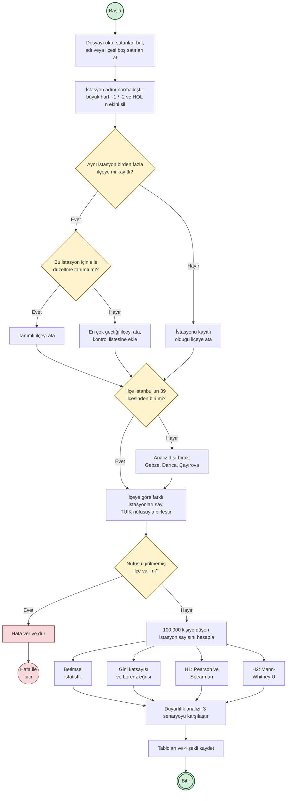
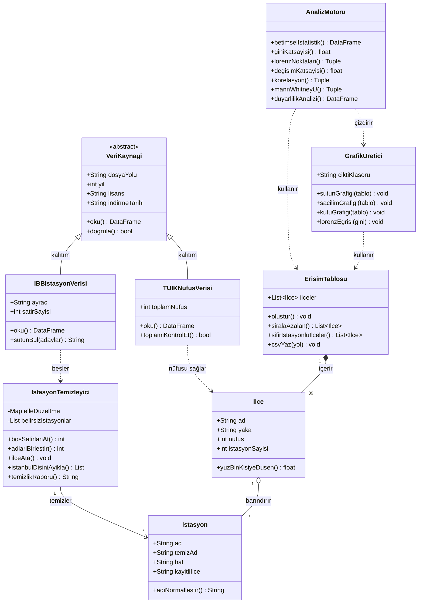

# UML Diyagramları

Bu klasörde projenin üç UML diyagramı var. Her diyagramın kaynağı Mermaid biçiminde (`.mmd`)
ve dışa aktarılmış görüntüsü (`.png`) birlikte tutuluyor. Aşağıdaki diyagramlar GitHub'da
doğrudan görüntüleniyor.

Projenin kendisi bir yazılım ürünü değil, bir veri analizi araştırması. Bu yüzden "sistem"
derken İBB ve TÜİK verilerini okuyup ilçe bazlı erişim tablosunu üreten analiz akışını
kastediyorum. Diyagramlar bu akışı modelliyor.

| Dosya | Diyagram |
|---|---|
| `1_use_case.mmd` / `.png` | Use Case (Kullanım Durumu) |
| `2_activity.mmd` / `.png` | Activity (Etkinlik) |
| `3_class.mmd` / `.png` | Class (Sınıf) |

---

## 1. Use Case Diyagramı (Kullanım Durumu)

```mermaid
%% Use Case Diyagramı
%% İstanbul'da İlçelerin Raylı Sistem Erişimi
flowchart TB
    A1(["Araştırmacı"])
    A2(["Başka bir<br/>araştırmacı"])

    subgraph SIS["Raylı Sistem Erişim Analizi — sistem sınırı"]
        direction TB
        UC1("Ham veriyi indir")
        UC2("Nüfus tablosunu hazırla")
        UC3("Veriyi temizle")
        UC4("İstasyonları ilçelere göre say")
        UC5("Analiz yap")
        UC6("Grafikleri üret")
        UC7("Sonuçları dışa aktar")
        UC8("Analizi yeniden çalıştır")

        UC3a("İstasyon adlarını birleştir")
        UC3b("İstanbul dışı istasyonları ayıkla")
        UC3c("Belirsiz ilçeyi elle düzelt")

        UC5a("Betimsel istatistik üret")
        UC5b("Orantılılığı ölç: Gini ve Lorenz")
        UC5c("Hipotezleri sına: H1 ve H2")
        UC5d("Duyarlılık analizi yap")
    end

    S1["İBB Açık Veri Portalı"]
    S2["TÜİK ADNKS"]

    A1 --- UC1
    A1 --- UC2
    A1 --- UC3
    A1 --- UC4
    A1 --- UC5
    A1 --- UC6
    A1 --- UC7
    A2 --- UC8
    A2 --- UC7

    UC1 --- S1
    UC2 --- S2

    UC3 -. include .-> UC3a
    UC3 -. include .-> UC3b
    UC3c -. extend .-> UC3

    UC5 -. include .-> UC5a
    UC5 -. include .-> UC5b
    UC5 -. include .-> UC5c
    UC5d -. extend .-> UC5c

    classDef aktor fill:#ffffff,stroke:#222,stroke-width:2px
    classDef dis fill:#f0f0f0,stroke:#777,stroke-dasharray:5 4
    classDef uc fill:#ffffff,stroke:#333
    class A1,A2 aktor
    class S1,S2 dis
    class UC1,UC2,UC3,UC4,UC5,UC6,UC7,UC8,UC3a,UC3b,UC3c,UC5a,UC5b,UC5c,UC5d uc
    style SIS fill:#fafafa,stroke:#444,stroke-width:2px
```

Diyagramın Mermaid kaynağı

### Diyagramda ne var?

**Aktörler.** Birincil aktör **Araştırmacı**, yani benim. Sistemi çalıştıran ve sonuçları
yorumlayan kişi. İkinci aktör **Başka bir araştırmacı**: deponun public olmasının nedeni bu,
analizi başkası da indirip yeniden çalıştırabilsin diye. Bilimsel bilginin tekrarlanabilir
olması gerektiği için bu aktörü diyagrama ayrıca koydum.

**İBB Açık Veri Portalı** ve **TÜİK ADNKS** sistemin dışında kalan veri sağlayıcılar. Onlara
komut veremiyorum, sadece yayımladıkları dosyayı indiriyorum. Bu yüzden onları sistem
sınırının dışına, kesik çizgili kutular olarak çizdim.

**Sistem sınırı.** Kutunun içindeki 11 kullanım durumu benim yazdığım analiz not defterinin
yaptığı işler.

### İlişkiler

`«include»` zorunlu bağımlılık demek: bir kullanım durumu her çalıştığında diğerini de
çalıştırıyor. Örneğin "İstasyonları ilçelere göre say" her zaman "Veriyi temizle"yi içeriyor,
çünkü temizlenmemiş veriyle sayım yanlış çıkıyor. Bunu projede bizzat yaşadım: temizlik
yapmadan 345 farklı istasyon adı görünüyordu, temizlikten sonra 309 oldu.

`«extend»` koşullu genişletme demek: her çalıştırmada olmuyor. "Belirsiz ilçeyi elle düzelt"
sadece bir istasyon birden fazla ilçeye kayıtlıysa devreye giriyor. "Duyarlılık analizi yap" da
hipotez sınamasını koşullu olarak genişletiyor; zorunlu bir adım değil ama sonucun verdiğim
kararlara bağlı olup olmadığını görmek için ekledim.

### Neden böyle tasarladım?

Kullanım durumlarını not defterindeki adımlarla birebir eşleştirdim. Hayalî özellikler
koymadım; diyagramdaki her kutunun karşılığı `analiz/analiz.ipynb` içinde bir hücre olarak var.

---

## 2. Activity Diyagramı (Etkinlik)

Diyagramın Mermaid kaynağı

### Diyagramda ne var?

Bu, projenin temel iş süreci: **ham veriden ilçe erişim tablosuna giden yol**. Dolu daire
başlangıç, çift daire bitiş düğümü. Dikdörtgenler işlem adımları, sarı eşkenar dörtgenler
karar noktaları.

### Karar noktaları

Beş karar var ve hepsi veriyi incelerken karşılaştığım gerçek sorunlardan çıktı:

1. **İstasyon adı veya ilçe boş mu?** Dosyada 1.144 böyle satır vardı, hepsi elendi.
2. **Aynı istasyon birden fazla ilçeye mi kayıtlı?** 13 istasyonda bu durum var.
3. **Elle düzeltme tanımlı mı?** Belirsiz istasyonları İBB hat haritasından kontrol ettikçe
   doğru ilçeyi koda yazıyorum. Tanımlı değilse en çok geçtiği ilçeye atanıyor ve kontrol
   listesine ekleniyor.
4. **İlçe İstanbul'da mı?** Veri setinde Kocaeli'ne bağlı Gebze, Darıca ve Çayırova
   istasyonları da var; bunlar analiz dışında kalıyor.
5. **Nüfusu girilmemiş ilçe var mı?** Varsa süreç hata ile duruyor. Eksik nüfusla hesaplanan
   bir oran sessizce yanlış sonuç üretir, bu yüzden burada durmayı tercih ettim.

### Paralel akış

"100.000 kişiye düşen istasyon sayısını hesapla" adımından sonra dört analiz birbirinden
bağımsız çalışabiliyor: betimsel istatistik, Gini ve Lorenz, H1 korelasyonu, H2 testi. Hiçbiri
diğerinin çıktısına ihtiyaç duymuyor. Dördü de duyarlılık analizinde tekrar birleşiyor.

### İki farklı bitiş

Normal bitişin yanında bir de hata ile bitiş var. Bir sürecin sadece mutlu yolunu çizmek
eksik olur; veri eksikse ne olacağını da göstermek gerekiyor.

### Neden böyle tasarladım?

Diyagram uydurma bir süreç değil, not defterinin aynası. Her kutunun karşılığı kodda var.
Birisi diyagrama bakıp not defterini açsa aynı sırayı görür.

---

## 3. Class Diyagramı (Sınıf)

Diyagramın Mermaid kaynağı

### Önce dürüst bir not

Analiz not defterim şu an **fonksiyonel** yazılmış, içinde sınıf yok. Bu diyagram, kodu
sınıflara taşıdığımda nasıl görüneceğini gösteren bir **tasarım önerisi**. Ödev metni de zaten
bunu istiyor: "kodlama aşamasına geçmeden önce sistemin yapısını ve işleyişini modellemeniz."
Diyagramdaki her metodun karşılığı not defterinde bir fonksiyon ya da hücre olarak var;
sınıflar bunları mantıklı gruplara topluyor.

### Sınıflar

- **VeriKaynagi** soyut sınıf. İki veri kaynağının ortak davranışını (dosyayı oku, doğrula) ve
  ortak özelliklerini (yıl, lisans, indirme tarihi) tutuyor. Lisans ve yıl bilgisini sınıfa
  koydum çünkü dersin kuralı bunların kayıt altında olmasını istiyor.
- **IBBIstasyonVerisi** ve **TUIKNufusVerisi** bu soyut sınıftan türüyor. İkisi de dosya okuyor
  ama farklı biçimde: İBB dosyası noktalı virgülle ayrılmış ve sütun adları değişebiliyor,
  TÜİK dosyasında ise 39 ilçenin toplamının il toplamına eşit olduğunu doğrulamak gerekiyor.
- **Istasyon** tek bir istasyonu temsil ediyor. Hem ham adını hem normalleştirilmiş adını
  tutuyor, çünkü temizlik öncesi ve sonrasını karşılaştırabilmem gerekiyor.
- **IstasyonTemizleyici** bütün temizlik işini üstleniyor: boş satırları atma, aynı istasyonun
  farklı yazımlarını birleştirme, belirsiz ilçeleri çözme, İstanbul dışını ayıklama. Elle
  düzeltme sözlüğünü ve kontrol edilecek istasyon listesini de bu sınıf tutuyor.
- **Ilce** bir ilçeyi temsil ediyor ve asıl ölçütü hesaplıyor: 100.000 kişiye düşen istasyon.
- **ErisimTablosu** 39 ilçeyi bir arada tutan sonuç tablosu.
- **AnalizMotoru** bütün hesapları yapıyor: betimsel istatistik, Gini, korelasyon,
  Mann-Whitney U, duyarlılık analizi.
- **GrafikUretici** dört şekli üretiyor.

### İlişki türleri ve neden öyle seçildiği

| İlişki | Nerede | Neden |
|---|---|---|
| **Kalıtım** (`<|--`) | VeriKaynagi → IBBIstasyonVerisi, TUIKNufusVerisi | İkisi de "veri kaynağı" olmanın ortak davranışını paylaşıyor, ayrıntıda farklılaşıyor |
| **Bileşim** (`*--`) | ErisimTablosu → Ilce | 39 ilçe satırı tabloya ait; tablo yoksa o satırların tek başına anlamı yok |
| **Birleşim** (`o--`) | Ilce → Istasyon | İlçe istasyonları barındırıyor ama istasyon ilçeden bağımsız bir varlık; ilçe sınırı değişse istasyon yerinde kalır |
| **Bağımlılık** (`..>`) | AnalizMotoru, GrafikUretici → ErisimTablosu | Tabloyu kullanıyorlar ama sahibi değiller, sadece okuyup sonuç üretiyorlar |

### Çokluklar

`ErisimTablosu "1" *-- "39" Ilce` yazdım, çünkü bu araştırma tam sayım: evren İstanbul'un 39
ilçesi ve hepsi tabloda. Sayı değişken değil, sabit. `IstasyonTemizleyici "1" --> "*" Istasyon`
ise değişken: kaç istasyon olduğu indirilen veri setine göre değişiyor.

---
