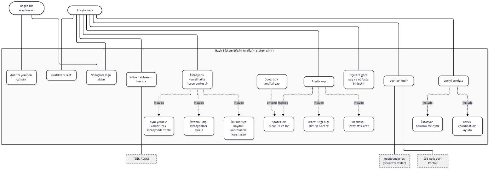
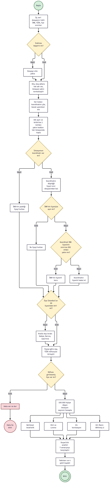
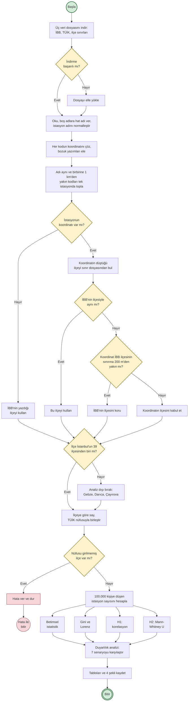
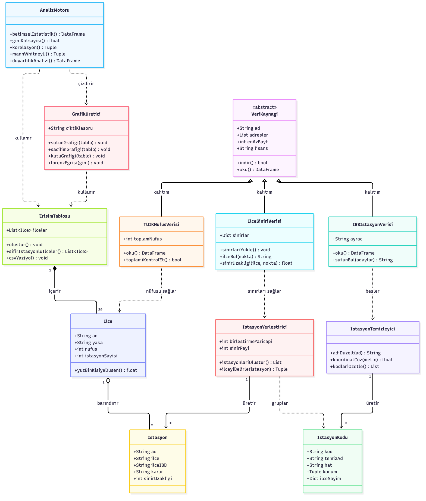
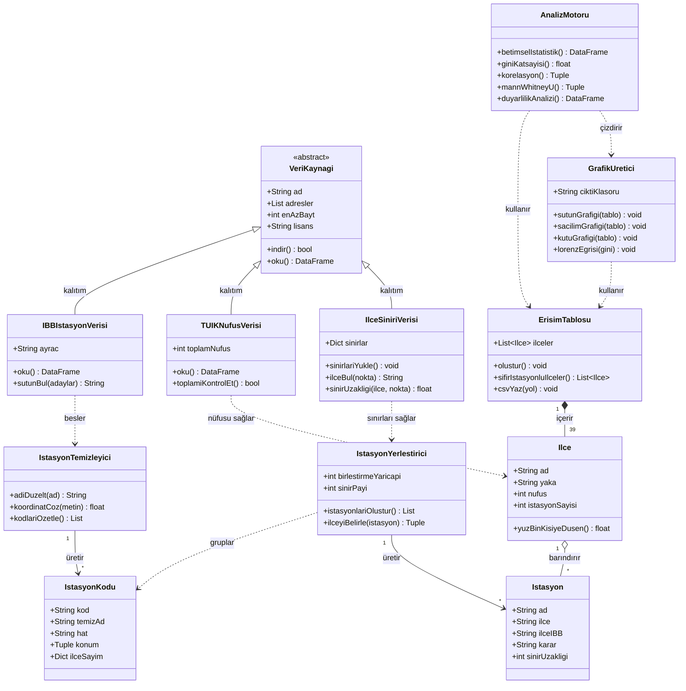

# UML Diyagramları

Bu klasörde projenin üç UML diyagramı var. Her diyagramın kaynağı Mermaid biçiminde (`.mmd`)
ve dışa aktarılmış görüntüsü (`.png`) birlikte tutuluyor.

Projenin kendisi bir yazılım ürünü değil, bir veri analizi araştırması. Bu yüzden "sistem"
derken İBB, TÜİK ve ilçe sınırı verilerini okuyup ilçe bazlı erişim tablosunu üreten analiz
akışını kastediyorum. Diyagramlar bu akışı modelliyor. Analiz akışını değiştirdiğimde (örneğin
istasyonların ilçesini koordinatla doğrulamaya başladığımda) diyagramları da güncelliyorum.

| Dosya | Diyagram |
|---|---|
| `1_use_case.mmd` / `.png` | Use Case (Kullanım Durumu) |
| `2_activity.mmd` / `.png` | Activity (Etkinlik) |
| `3_class.mmd` / `.png` | Class (Sınıf) |

---

## 1. Use Case Diyagramı (Kullanım Durumu)

```mermaid
%% Use Case Diyagramı
%% İstanbul'da İlçelerin Raylı Sistem Erişimi
flowchart TB
    A1(["Araştırmacı"])
    A2(["Başka bir<br/>araştırmacı"])

    subgraph SIS["Raylı Sistem Erişim Analizi — sistem sınırı"]
        direction TB
        UC1("Verileri indir")
        UC2("Nüfus tablosunu hazırla")
        UC3("Veriyi temizle")
        UC4("İstasyonu koordinatla ilçeye yerleştir")
        UC5("İlçelere göre say ve nüfusla birleştir")
        UC6("Analiz yap")
        UC7("Grafikleri üret")
        UC8("Sonuçları dışa aktar")
        UC9("Analizi yeniden çalıştır")

        UC3a("İstasyon adlarını birleştir")
        UC3b("Bozuk koordinatları ayıkla")

        UC4a("Aynı yerdeki kodları tek istasyonda topla")
        UC4b("İBB'nin ilçe kaydını koordinatla karşılaştır")
        UC4c("İstanbul dışı istasyonları ayıkla")

        UC6a("Betimsel istatistik üret")
        UC6b("Orantılılığı ölç: Gini ve Lorenz")
        UC6c("Hipotezleri sına: H1 ve H2")
        UC6d("Duyarlılık analizi yap")
    end

    S1["İBB Açık Veri Portalı"]
    S2["TÜİK ADNKS"]
    S3["geoBoundaries<br/>(OpenStreetMap)"]

    A1 --- UC1
    A1 --- UC2
    A1 --- UC3
    A1 --- UC4
    A1 --- UC5
    A1 --- UC6
    A1 --- UC7
    A1 --- UC8
    A2 --- UC9
    A2 --- UC8

    UC1 --- S1
    UC1 --- S3
    UC2 --- S2

    UC3 -. include .-> UC3a
    UC3 -. include .-> UC3b

    UC4 -. include .-> UC4a
    UC4 -. include .-> UC4b
    UC4 -. include .-> UC4c

    UC6 -. include .-> UC6a
    UC6 -. include .-> UC6b
    UC6 -. include .-> UC6c
    UC6d -. extend .-> UC6c

    classDef aktor fill:#ffffff,stroke:#222,stroke-width:2px
    classDef dis fill:#f0f0f0,stroke:#777,stroke-dasharray:5 4
    classDef uc fill:#ffffff,stroke:#333
    class A1,A2 aktor
    class S1,S2,S3 dis
    class UC1,UC2,UC3,UC4,UC5,UC6,UC7,UC8,UC9,UC3a,UC3b,UC4a,UC4b,UC4c,UC6a,UC6b,UC6c,UC6d uc
    style SIS fill:#fafafa,stroke:#444,stroke-width:2px
```

Diyagramın Mermaid kaynağı

### Diyagramda ne var?

**Aktörler.** Birincil aktör **Araştırmacı**, yani benim. Sistemi çalıştıran ve sonuçları yorumlayan
kişi. İkinci aktör **Başka bir araştırmacı**: deponun public olmasının nedeni bu, analizi başkası da
indirip yeniden çalıştırabilsin diye. Bilimsel bilginin tekrarlanabilir olması gerektiği için bu aktörü
diyagrama ayrıca koydum.

**İBB Açık Veri Portalı**, **TÜİK ADNKS** ve **geoBoundaries (OpenStreetMap)** sistemin dışında kalan
veri sağlayıcılar. Onlara komut veremiyorum, sadece yayımladıkları dosyayı indiriyorum. Bu yüzden onları
sistem sınırının dışına, kesik çizgili kutular olarak çizdim. İlçe sınırları, istasyonların ilçesini
koordinatla doğrulamak için gerekiyor.

**Sistem sınırı.** Kutunun içindeki kullanım durumları, yazdığım analiz not defterinin yaptığı işler.

### İlişkiler

`«include»` zorunlu bağımlılık demek: bir kullanım durumu her çalıştığında diğerini de çalıştırıyor.
"İstasyonu koordinatla ilçeye yerleştir" her zaman üç işi içeriyor: aynı yerdeki kodları tek istasyonda
toplama, İBB'nin ilçe kaydını koordinatla karşılaştırma ve İstanbul dışı istasyonları ayıklama. Bunu
projede bizzat yaşadım: ilçeyi koordinatla doğrulamasam Gini katsayısı 0,519 çıkıyordu, doğrulayınca
0,500. "Analiz yap" da her çalıştığında betimsel istatistik, Gini ölçümü ve hipotez sınamasını
içeriyor. "Veriyi temizle" ise istasyon adlarını birleştirmeyi ve bozuk koordinatları ayıklamayı içeriyor.

`«extend»` koşullu genişletme demek: her çalıştırmada olmuyor. "Duyarlılık analizi yap", hipotez
sınamasını koşullu olarak genişletiyor; zorunlu bir adım değil ama sonucun verdiğim kararlara bağlı
olup olmadığını görmek için ekledim.

### Neden böyle tasarladım?

Kullanım durumlarını not defterindeki adımlarla birebir eşleştirdim. Hayalî özellikler koymadım;
diyagramdaki her kutunun karşılığı `analiz/analiz.ipynb` içinde bir hücre ya da fonksiyon olarak var.

---

## 2. Activity Diyagramı (Etkinlik)

Diyagramın Mermaid kaynağı

### Diyagramda ne var?

Bu, projenin temel iş süreci: **veri indirmeden ilçe erişim tablosuna giden yol**. Dolu daire başlangıç,
çift halka bitiş düğümü. Dikdörtgenler işlem adımları, sarı eşkenar dörtgenler karar noktaları.

### Karar noktaları

Altı karar var ve hepsi veriyle çalışırken karşılaştığım gerçek sorunlardan çıktı:

1. **İndirme başarılı mı?** Not defteri üç veri dosyasını kaynağından kendisi indiriyor. Sunucu yanıt
   vermezse ya da yarım dosya gönderirse (İBB sunucusu bir denememde 14 MB'ın 10,8 MB'ında bağlantıyı
   kesti) dosya elle yükleniyor.
2. **İstasyonun koordinatı var mı?** 322 istasyondan 56'sının koordinatı yok ya da kullanılamıyor
   (Excel'de bozulmuş). Onlarda İBB'nin yazdığı ilçe kullanılıyor.
3. **Koordinatın ilçesi İBB'ninkiyle aynı mı?** 322 istasyondan 234'ünde aynı çıktı. Fark çıkarsa
   sıradaki karara geçiliyor.
4. **Koordinat İBB'nin ilçesinin sınırına 200 m'den yakın mı?** Yakınsa İBB'nin kaydı korunuyor, çünkü
   sınır dosyası resmî değil ve birkaç on metre sapabilir. Uzaksa koordinatın ilçesi kabul ediliyor
   (17 istasyonda böyle oldu).
5. **İlçe İstanbul'un 39 ilçesinden biri mi?** Veri setinde Kocaeli'ne bağlı Gebze, Darıca ve Çayırova
   istasyonları da var, onlar analiz dışında kalıyor.
6. **Nüfusu girilmemiş ilçe var mı?** Varsa süreç hata ile duruyor. Eksik nüfusla hesaplanan bir oran
   sessizce yanlış sonuç üretir, bu yüzden burada durmayı tercih ettim.

### Paralel akış

"100.000 kişiye düşen istasyon sayısını hesapla" adımından sonra dört analiz birbirinden bağımsız
çalışabiliyor: betimsel istatistik, Gini ve Lorenz, H1 korelasyonu, H2 testi. Hiçbiri diğerinin
çıktısına ihtiyaç duymuyor. Dördü de duyarlılık analizinde tekrar birleşiyor.

### İki farklı bitiş

Normal bitişin yanında bir de hata ile bitiş var. Bir sürecin sadece mutlu yolunu çizmek eksik olur;
veri eksikse ne olacağını da göstermek gerekiyor.

### Neden böyle tasarladım?

Diyagram uydurma bir süreç değil, not defterinin aynası. Her kutunun karşılığı kodda var. Birisi
diyagrama bakıp not defterini açsa aynı sırayı görür.

---

## 3. Class Diyagramı (Sınıf)

Diyagramın Mermaid kaynağı

### Önce dürüst bir not

Analiz not defterim şu an **fonksiyonel** yazılmış, içinde sınıf yok. Bu diyagram, kodu sınıflara
taşıdığımda nasıl görüneceğini gösteren bir **tasarım önerisi**. Ödev metni de zaten bunu istiyor:
"kodlama aşamasına geçmeden önce sistemin yapısını ve işleyişini modellemeniz." Diyagramdaki her
metodun karşılığı not defterinde bir fonksiyon olarak var; sınıflar bunları mantıklı gruplara topluyor.

### Sınıflar

- **VeriKaynagi** soyut sınıf. Üç veri kaynağının ortak davranışını (adresten indir, oku) ve ortak
  özelliklerini (adresler, en az beklenen boyut, lisans) tutuyor. Lisans bilgisini sınıfa koydum çünkü
  dersin kuralı kaynak ve lisansın kayıt altında olmasını istiyor. En az boyut ise sunucu gerçek dosya
  yerine kısa bir hata metni verirse bunu anlamak için.
- **IBBIstasyonVerisi**, **TUIKNufusVerisi** ve **IlceSiniriVerisi** bu soyut sınıftan türüyor. Üçü de
  dosya okuyor ama farklı biçimde: İBB dosyası noktalı virgülle ayrılmış ve sütun adları değişebiliyor,
  TÜİK dosyasında 39 ilçenin toplamının il toplamına eşit olduğunu doğrulamak gerekiyor, sınır dosyasında
  ise bir noktanın hangi ilçeye düştüğünü bulmak gerekiyor.
- **IstasyonKodu** İBB dosyasındaki bir istasyon kodunu temsil ediyor. Bir istasyon birden fazla koda
  sahip olabiliyor (örneğin Yenikapı'nın beş kodu var), o yüzden kodla istasyonu ayırdım.
- **IstasyonTemizleyici** kodları temizliyor: adı normalleştiriyor, bozuk koordinatı çözüyor ve her kodu
  tek satırlık özete indiriyor.
- **IstasyonYerlestirici** projenin en önemli sınıfı. Aynı yerdeki kodları tek **Istasyon**'da topluyor
  ve istasyonun ilçesini belirliyor. 1000 m'lik birleştirme yarıçapı ve 200 m'lik sınır payı bu sınıfın
  ayarları.
- **Istasyon** analize giren tek bir istasyonu temsil ediyor. İBB'nin yazdığı ilçeyi ve kararın
  dayanağını da tutuyor, çünkü bir ilçeyi neden değiştirdiğimi gösterebilmem gerekiyor.
- **Ilce** bir ilçeyi temsil ediyor ve asıl ölçütü hesaplıyor: 100.000 kişiye düşen istasyon.
- **ErisimTablosu** 39 ilçeyi bir arada tutan sonuç tablosu.
- **AnalizMotoru** bütün hesapları yapıyor: betimsel istatistik, Gini, korelasyon, Mann-Whitney U,
  duyarlılık analizi. **GrafikUretici** dört şekli üretiyor.

### İlişki türleri ve neden öyle seçildiği

| İlişki | Nerede | Neden |
|---|---|---|
| **Kalıtım** (`<|--`) | VeriKaynagi → üç veri sınıfı | Üçü de "veri kaynağı" olmanın ortak davranışını paylaşıyor, ayrıntıda farklılaşıyor |
| **Bileşim** (`*--`) | ErisimTablosu → Ilce | 39 ilçe satırı tabloya ait; tablo yoksa o satırların tek başına anlamı yok |
| **Birleşim** (`o--`) | Ilce → Istasyon | İlçe istasyonları barındırıyor ama istasyon ilçeden bağımsız bir varlık; ilçe sınırı değişse istasyon yerinde kalır |
| **Bağımlılık** (`..>`) | AnalizMotoru, GrafikUretici → ErisimTablosu | Tabloyu kullanıyorlar ama sahibi değiller, sadece okuyup sonuç üretiyorlar |

### Çokluklar

`ErisimTablosu "1" *-- "39" Ilce` yazdım, çünkü bu araştırma tam sayım: evren İstanbul'un 39 ilçesi ve
hepsi tabloda. Sayı değişken değil, sabit. `IstasyonYerlestirici "1" --> "*" Istasyon` ise değişken:
kaç istasyon çıktığı veri setine ve yarıçapa göre değişiyor.

---
